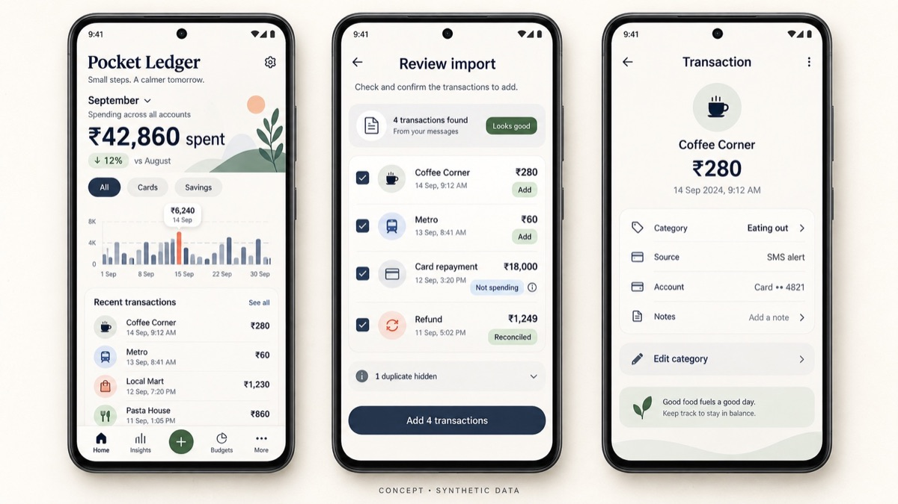

# Pocket Ledger

A privacy-first Android personal finance app that brings spending across credit cards and savings accounts into one clear ledger while keeping financial records and processing on the device. A private prototype is in progress; this repository is the public case study.

*Concept UI using entirely synthetic financial data. See [the visual product notes](./VISUAL_PRODUCT.md).*

## Why I am building it

Money leaves through several accounts, cards, refunds, transfers, and repayments, while the useful record is scattered across alerts and statements. Pocket Ledger is meant to answer a simple question without asking for another financial login: what did I actually spend, and through which account?

The difficult part is not drawing a chart. It is turning inconsistent transaction alerts into one trustworthy ledger without double-counting a card repayment, treating a transfer as spending, accepting a declined charge, or missing a refund.

## Product principles

- **Local by default.** Financial records are stored and processed on the Android device.
- **No account required.** No Pocket Ledger signup or app-owned cloud database.
- **Permission with a purpose.** A data source is requested only when the user chooses to import from it.
- **Explain the ledger.** Imported transactions should retain enough source context for a user to verify and correct them.
- **Corrections are first-class.** Manual entries and category corrections belong in the normal workflow.
- **Avoid false totals.** Declines, duplicates, refunds, owned-account transfers, and credit-card repayments must be handled explicitly.

## First-version scope

The list below is the intended first version, not a changelog of the private prototype. SMS import is in progress there; see [Current status](#current-status) for what the reviewed v0.4.1 source implements.

1. Import transaction alerts from SMS with explicit user permission.
2. Recognize the bank, account type, masked account identifier, amount, direction, merchant, and timestamp when the message provides them.
3. Reject declined transactions and suppress duplicate alerts.
4. Reconcile refunds, transfers between owned accounts, and credit-card repayments so they do not distort spending.
5. Show a combined expense view with filters for an individual card or savings account.
6. Let the user add a transaction manually or correct its category.

Gmail and statement import are being evaluated, but they are not part of the confirmed first version.

## Privacy boundary

- Financial content is processed locally, with no cloud AI processing or automatic cloud backup.
- Test builds send usage and crash reports only when a nonempty reporting key is configured and the first-launch notice has been accepted. The reviewed v0.4.1 source has no in-app off switch after acceptance. Reports include usage events and approximate location derived by the reporting provider from the network address, never amounts, merchants, account details, or SMS text.
- Real SMS messages, emails, statements, account identifiers, credentials, and signing keys never belong in a public repository.
- Development uses synthetic or redacted transaction fixtures.
- Exports are user initiated. The ledger is encrypted on the device; portable backups are passphrase-encrypted. CSV exports are readable files and need a private destination.

## Current status

The private Android source reviewed on 22 October 2026 identifies version
**0.4.1**. This is a source snapshot, not a claim that a particular APK or device
has been updated. There is no Play Store release described here.

That source implements:

- SMS debit import with permission, review, and re-checking
- Account names, categories, manual entries, and corrections
- Screenshot blocking, enabled by default
- User-started CSV export
- An encrypted on-device ledger protected by Android Keystore
- Passphrase-encrypted backup and restore through the Android file picker
- Test-build usage and crash reporting only when a nonempty reporting key is configured and the first-launch notice has been accepted

Financial records and SMS processing stay on the phone. Test reporting is a
separate network flow requiring both a configured, nonempty reporting key and
acceptance of the first-launch notice. The reviewed v0.4.1 source has no in-app
off switch after acceptance; unconfigured builds do not send these reports.
Uninstalling removes the local ledger and its key. Recovery requires an exported
backup and its passphrase; automatic cloud backup is disabled. A CSV is not an
encrypted backup.

The implemented import scope is debits only. Credits, including refunds, are
excluded; broader reconciliation remains planned work. Parsing accuracy still
needs review against supported bank alerts.

## What this repository is

A public product case study, visual product direction, and planned system architecture. See `VISUAL_PRODUCT.md` and `ARCHITECTURE.md`.

The application source, financial parsing rules, bank-specific templates, test corpus, and all personal financial data stay private. No application code is published here.

## Who is building it

Yashasvi Shailly. Product, design, and engineering.
